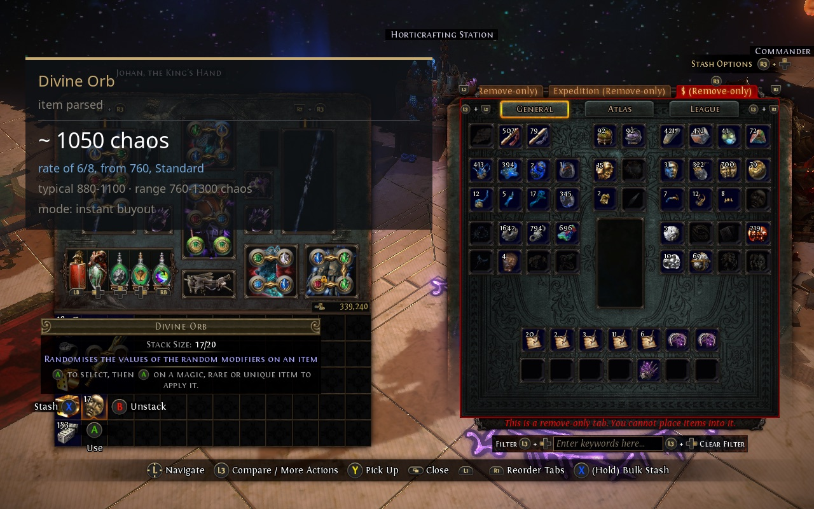
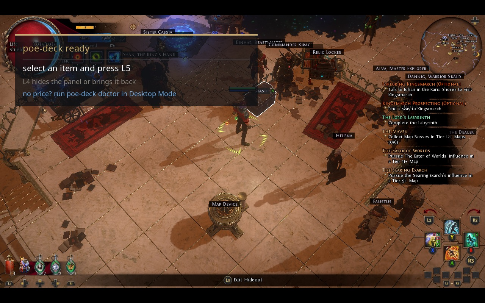

# poe-deck

A price check for Path of Exile on the **Steam Deck**. Select an item with the
gamepad, press L5 (the lower left back button), and the price shows up on top
of the game. You stay in Game Mode and need no keyboard or mouse.





Both pictures are real screenshots from a Steam Deck in Game Mode.

## What it does

- Price check for Path of Exile 1: items with mods, currency, maps, fragments
  and uniques.
- The price is the median of the first listings on the official trade site.
  The range and the number of listings are shown next to it, so one cheap bait
  listing does not set the price.
- You can edit the search on the panel with the right trackpad: switch mods on
  and off, change min and max, pick the market.
- `poe-deck doctor` checks each part of the setup and says what to fix.
- A controller layout template comes with it. You apply it once in Controller
  Settings and do not set up any buttons by hand.

## What it does not do

- Path of Exile 2 is not supported yet.
- Desktop Mode is not supported. poe-deck runs only in Game Mode.
- It has no loot filter editor.
- It reads only the English game client.

## Install

Download the archive from [Releases](https://github.com/Stonkszilla/poe-deck/releases)
and follow [the install steps](docs/player/README.md#install). It takes about
five minutes in Desktop Mode and needs no `sudo` and no developer mode.

Buttons, settings, `doctor`, update, uninstall and bug reports are in the same
guide: [docs/player/README.md](docs/player/README.md).

## Verify a release

Every release archive is built by
[`.github/workflows/release.yml`](.github/workflows/release.yml) on a GitHub
runner from the tagged commit and carries a signed build provenance
attestation. Check that the file you downloaded came from that workflow in
this repository:

```sh
gh attestation verify poe-deck-vX.Y.Z-steamos-x86_64.tar.gz --repo Stonkszilla/poe-deck
```

A file that fails this check did not come from here, whatever its name says.
Releases are immutable: once published, their files cannot be swapped.
Commits and tags on `main` are signed; GitHub shows them as **Verified**.

## Build from source

Needs Docker and git. The same script the release workflow runs:

```sh
git clone --recurse-submodules https://github.com/Stonkszilla/poe-deck.git
cd poe-deck
POE_DECK_VERSION=dev bash ci/bundle/build.sh dist
```

## Credits and license

poe-deck is MIT-licensed and non-commercial, see [`LICENSE`](LICENSE).
Third-party licenses are in [`licenses/`](licenses/).

- The item parser and the game data come from
  [awakened-poe-trade](https://github.com/SnosMe/awakened-poe-trade) by Alexander
  Drozdov (MIT), pinned to one commit as a submodule in `vendor/`. The trade
  rate limiter is ported from it too.
- [scalpel](https://github.com/scalpelpoe/scalpel) gave ideas. No code from
  scalpel is in poe-deck.
- The Game Mode button protocol description comes from
  [gamescope](https://github.com/ValveSoftware/gamescope) (MIT).

poe-deck is a fan project. It is not affiliated with or endorsed by Grinding Gear
Games or Valve.
