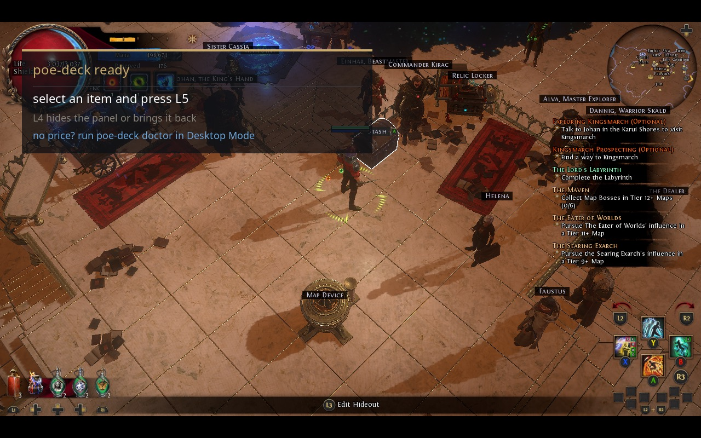
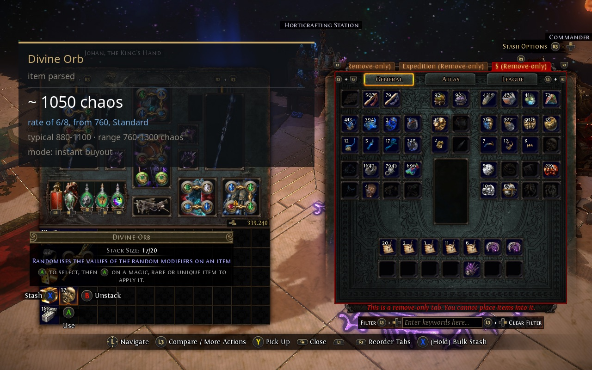
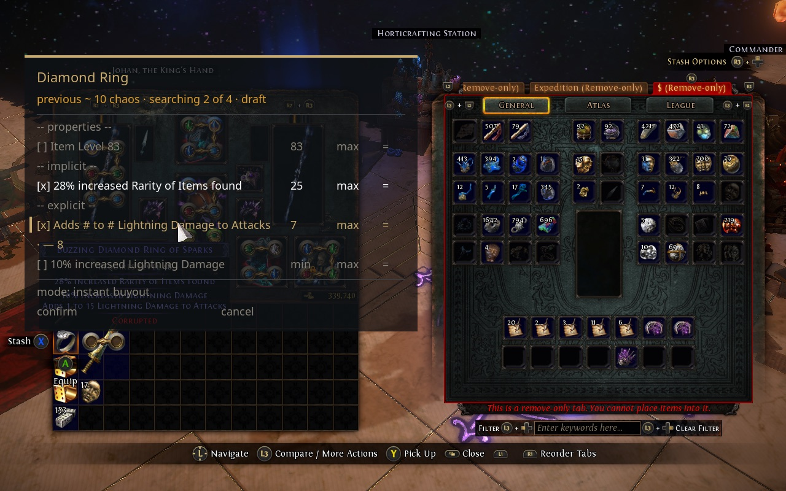

**faustus** — the rate of the in-game Currency Exchange (Faustus), from poe.ninja. The
trade site does not see this market, so for currency the panel shows it as the main
price, with the trade price on a line below. Without it the trade price is the main
price and still works.

| You see | Fix |
|---|---|
| `poe.ninja has no Currency Exchange rates for …` | ✓, nothing to fix: poe.ninja does not track this league (a private one, or a league that just started); the panel shows the trade price only |
| `poe.ninja — …; the panel shows the trade price only` | check Wi-Fi, then run doctor again |
# poe-deck — price check for Path of Exile on the Steam Deck

Select an item in Path of Exile with the gamepad, press **L5** (the lower left
back button), and its price shows up on top of the game. No keyboard, no mouse,
no leaving Game Mode.





All pictures on this page are real screenshots from a Steam Deck in Game Mode.

## What it does and what it does not

poe-deck does:

- **price check for Path of Exile 1 in Game Mode** — items with mods, currency,
  maps, fragments, uniques;
- show the price as a **median of the first listings** on the official trade site,
  with the range and the number of listings next to it, so one cheap bait listing
  does not decide the price;
- let you **edit the search** on the panel with the right trackpad: switch mods on
  and off, change min and max, change the market (instant buyout, in person, any);
- **check a map before you run it** — for a map with mods the panel marks each mod
  as deadly, warning or good, from a profile you can edit; L5 again shows its price.

poe-deck does not:

- **Path of Exile 2** — not yet;
- **Desktop Mode** — the daemon only works in Game Mode and waits there quietly;
- **loot filters** — there is no loot filter editor;
- a game client in another language than **English** — the item parser reads the
  English item text;
- other devices than the Steam Deck with SteamOS.

Known issue: Steam's **performance overlay** (the FPS counter from the Quick
Access Menu) does not work while poe-deck runs. Both use the same overlay layer
in Game Mode.

## Install

You need the Steam version of Path of Exile, set to English, and about five minutes
in Desktop Mode.

1. Download two files from the poe-deck [**Releases**](https://github.com/Stonkszilla/poe-deck/releases) page:
   `poe-deck-vX.Y.Z-steamos-x86_64.tar.gz` and
   `poe-deck-vX.Y.Z-steamos-x86_64.tar.gz.sha256`. Keep them in one folder,
   for example `~/Downloads`.
2. Open **Konsole** (Desktop Mode → application launcher → System → Konsole).
3. Go to the folder and set `V` to the version you downloaded:

   ```sh
   cd ~/Downloads
   V=vX.Y.Z
   ```

4. Check the download. The answer must be `OK`; anything else means a broken
   or a different file — download it again and do not install it.

   ```sh
   sha256sum -c poe-deck-$V-steamos-x86_64.tar.gz.sha256
   ```

5. Unpack and install:

   ```sh
   tar xzf poe-deck-$V-steamos-x86_64.tar.gz
   sh poe-deck-$V/install.sh
   ```

The installer needs no `sudo`, no password, no developer mode and no compiler.
Everything goes into your home folder, so SteamOS updates do not remove it:

| What | Where |
|---|---|
| the program | `~/.local/share/poe-deck/` |
| the background service | `~/.config/systemd/user/poe-deck.service` |
| the controller layout template | `~/.local/share/Steam/controller_base/templates/controller_neptune_poe_deck.vdf` |
| your settings | `~/.config/poe-deck/poe-deck.conf` |

The last lines of a good install look like this:

```
✓  poe-deck is installed and waits for Game Mode (normal in Desktop Mode)

Installed: poe-deck vX.Y.Z (…)
Layout:    Game Mode → Path of Exile → Controller Settings → Browse Layouts → Templates → poe-deck
```

"Waits for Game Mode" is the normal answer in Desktop Mode, not an error.

### Apply the controller layout

The buttons come from a Steam Input layout template. Apply it once:

1. Switch to **Game Mode** (desktop icon "Return to Gaming Mode").
2. Open **Path of Exile** in your library → gear icon → **Controller Settings**.
3. **Browse Layouts** → **Templates** → **poe-deck** → **Apply**.

The template is not in the list? Restart Steam: **Steam button → Power → Restart
Steam**, then look again.

The template is the stock gamepad layout for Path of Exile with three changes. They
are listed in the next section.

## Buttons

| Button | What it does |
|---|---|
| **L5** (lower left back button) | price check of the selected item |
| **L4** (upper left back button) | hide the price panel, or bring the last result back |
| **right trackpad** | move the cursor on the panel; click the trackpad to press |

**L3** (click the left stick) stays with the game: in gamepad mode it shows the
item's advanced description. **R5** (lower right back button) is a second left
stick click, as in the stock layout.

How a price check goes:

1. Select an item with the normal gamepad navigation — in the stash, the inventory,
   a vendor window. The game shows the item's tooltip.
2. Press **L5**. The panel shows the item name at once and the price a moment later.
3. The panel goes away on its own after 15 seconds. **L4** hides it sooner.
   Press **L4** again to bring back the same result — this sends nothing to trade.

For currency and other items of the in-game Currency Exchange (fragments, essences,
fossils, oils, omens), the panel also shows how the poe.ninja rate moved over the
last 7 days: one small bar per day and the change in percent, for example
`7 days -16%`. It is red when the rate fell by 5 % or more and green when it rose
by 5 % or more, so a crashing price shows before you sell. There is no graph when
poe.ninja knows fewer than three days of trades for the item, or the item trades
for less than 50 chaos a day: such a week is noise. Prices from trade listings —
rares, uniques, maps — have no week graph: poe.ninja keeps no history for one
specific item.

The first time you enter the game after installing, the panel says
`poe-deck ready — select an item and press L5` once.

### Edit the search on the panel



Touch the **right trackpad** and move the cursor onto the panel. The panel opens the
list of the item's mods. While the cursor is on the panel, it does not go away.

- Click a mod line to switch it on `[x]` or off `[ ]`.
- Click `min` or `max` to change a limit: move your finger up for more, down for
  less, click again to finish.
- Click the `mode:` line to switch the market: instant buyout → in person → …
- Click **confirm** to search again with your changes, **cancel** to drop them.

Move the cursor away from the panel and it closes the list after a moment.

## Map check

Select a map with mods (magic, rare or unique) and press **L5**, as for a price
check. Instead of the price, the panel shows the map check:

- the first line is the answer — `do not run: 1 deadly`, `run with care: 2 warnings`
  or `nothing dangerous`;
- below it every mod of the map, with a mark in front: **DEADLY** (red),
  **WARN** (orange), **GOOD** (green), or `·` for a mod the profile does not mention.

The screen has room for one of the two, and for a map the first question is
whether to run it. The price is one more press away: the bottom line of the
panel says what the next **L5** does.

- **L5 again** on the same map, while the panel is on the screen, shows its price.
  This is the only press that asks the trade site.
- **L5 once more** goes back to the map check, and further presses switch between
  the two without asking again. The price shows how old it is.

A map without mods (white or unidentified) still gets its price at once.
**L4** hides the panel and brings it back, the same way as a price; after **L4**,
**L5** on the same map brings back what you saw last, and the next **L5** switches
again. The map check itself asks nothing of the trade site.

### The map check profile

The marks come from a profile — a text file with one rule per line:

```
deadly = reflect #% of physical damage
warning = players are cursed with
good = rogue exile
```

A rule matches a part of the mod text, without regard to case. Every number in the
mod counts as `#`. If a mod matches rules of two marks, the worse mark wins.

The default profile marks physical and elemental reflect, no regeneration and no
leech as deadly. To change it, save your own copy and edit it in Desktop Mode:

```sh
~/.local/share/poe-deck/poe-deck map-profile > ~/.config/poe-deck/map-check.profile
kate ~/.config/poe-deck/map-check.profile
systemctl --user restart poe-deck
```

Your file `~/.config/poe-deck/map-check.profile` replaces the default completely.
A line with a mistake is skipped, the other lines still work. To check what your
profile does with a map without the game, copy the map text to a file and run
`~/.local/share/poe-deck/poe-deck --check-map <file>`. To go back to the default, delete your file and
restart the service.

## Settings: league and market

The settings file is `~/.config/poe-deck/poe-deck.conf`. The installer creates it from
an example the first time and never overwrites it later. Edit it in Desktop Mode with
any text editor (for example Kate):

```sh
kate ~/.config/poe-deck/poe-deck.conf
```

| Setting | Empty means | Example |
|---|---|---|
| `league` | the current softcore trade league, picked on its own every session | `league = Standard` |
| `price_mode` | `securable` — instant buyout | `price_mode = online` |
| `panel_ttl` | 15 seconds on screen (1 to 600) | `panel_ttl = 30` |

`price_mode` takes one of: `securable` (instant buyout), `available` (instant
buyout or in person), `online` (in person, seller online), `onlineleague` (in person,
seller online in the league), `any` (any listing, including offline sellers).

The league name must match the trade site exactly: `Hardcore`, `Standard`, the
current league name. After a change, restart the service:

```sh
systemctl --user restart poe-deck
```

**Private leagues** need your `POESESSID` session cookie. It is never read from the
settings file. Put it into the service instead:

```sh
systemctl --user edit poe-deck
```

and add these lines in the editor that opens:

```
[Service]
Environment=POE_DECK_POESESSID=<your POESESSID>
```

Treat this cookie like a password: anyone who has it is logged in to your
pathofexile.com account. Public leagues never need it.

## doctor: what is wrong

`doctor` checks every link of the chain and prints one line per link: ✓ works,
✗ broken, with a `fix:` line below that says what to do.

```sh
~/.local/share/poe-deck/poe-deck doctor
```

A healthy Deck:

```
poe-deck doctor — vX.Y.Z (…), poe1
✓  config    /home/deck/.config/poe-deck/poe-deck.conf
✓  protocol  gamescope_action_binding_manager version 1
✓  binaries  5 in /home/deck/.local/share/poe-deck, ldd: all libraries found
✓  layout    price check on L5, hide / bring back on L4 (templates/controller_neptune_poe_deck.vdf)
✓  network   trade API and poe.ninja reachable
✓  league    Covens (current softcore trade league)
✓  faustus   Currency Exchange rates from poe.ninja: 105 currencies in Covens
✓  all 7 checks passed
```

The exit code is 0 only when every line is ✓.

**Run it in Game Mode for the full answer.** In Desktop Mode the `protocol` line is
always ✗ (`no gamescope socket — this is not a Game Mode session`): the button
channel exists only in Game Mode. The other six lines are correct in Desktop Mode
too. To run doctor in Game Mode, add Konsole to Steam once (Desktop Mode → Steam →
Games → **Add a Non-Steam Game to My Library** → Konsole), start it from your library
in Game Mode and open the on-screen keyboard with **Steam + X**.

### Every ✗ and what to do

**config** — the settings file has a line poe-deck cannot use. The line number is
in the message.

| You see | Fix |
|---|---|
| `line N: expected "key = value", got "…"` | write the line as `key = value`, or delete it |
| `line N: unknown key "…" — known keys: league, price_mode, panel_ttl` | a typo in the key name |
| `line N: "…" is set twice — keep one line` | delete one of the two lines |
| `line N: price_mode: unknown search mode "…", expected: …` | use one of the names in the message |
| `line N: panel_ttl: "…" is not a number of seconds from 1 to 600` | a whole number from 1 to 600 |
| `cannot read the file: …` | the path is not a normal readable file; delete it and copy the example again (below) |

An empty file or no file at all means defaults. To start over from the example:
`cp ~/.local/share/poe-deck/poe-deck.conf.example ~/.config/poe-deck/poe-deck.conf`.

**protocol** — the button channel inside Game Mode.

| You see | Fix |
|---|---|
| `no gamescope socket — this is not a Game Mode session` | normal in Desktop Mode; run doctor in Game Mode |
| `gamescope is here, gamescope_action_binding_manager is not in the registry` | a SteamOS update removed the part of Game Mode poe-deck listens to. poe-deck cannot work on this SteamOS version — report it with the doctor output |
| `no hotkey probe: …` | the install is incomplete: run `install.sh` from the unpacked archive again |
| `probe returned 127, …` with `fix: the probe cannot start — see the binaries line below` | look at the `binaries` line |
| `probe returned N, could not parse its answer` | run the command from the `fix:` line in Game Mode and attach its output to a bug report |
| `probe gave no answer in 10s` or `probe did not start: …` | reboot the Deck and run doctor again; if it repeats, report it |

**binaries** — the programs that come in the archive.

| You see | Fix |
|---|---|
| `… missing` or `… is not executable` | the install is incomplete: run `install.sh` from the unpacked archive again |
| `… lacks <library>` | a system library is missing; on a stock SteamOS this should not happen — report it |
| `system commands missing: timeout, xprop` (or one of them) | these come with SteamOS; this does not look like a stock SteamOS |
| `ldd not found — libraries not checked` | `ldd` comes with SteamOS; this does not look like a stock SteamOS |

**layout** — the controller layout of Path of Exile.

| You see | Fix |
|---|---|
| `Path of Exile has no Steam Input layout of its own yet` | apply the template: see [Apply the controller layout](#apply-the-controller-layout) |
| `no button sends price check (Control_L+Alt_L+C)` or `… hide / bring back (Control_L+Shift_L)` | the game uses another layout, or a button was changed; apply the poe-deck template again |
| `… (the poe-deck template is not installed either — run the installer again)` | run `install.sh` from the unpacked archive again, then apply the template |

**network** — Wi-Fi and the two sites poe-deck checks.

| You see | Fix |
|---|---|
| `pathofexile.com — cannot connect (…)` or `— no answer in …s` | check Wi-Fi (Steam button → Settings → Internet), then run doctor again |
| `poe.ninja — cannot connect (…)` | the same: check Wi-Fi |
| `pathofexile.com — GGG servers are down: …` | not your Wi-Fi: maintenance or a patch; try again when pathofexile.com is back |
| `pathofexile.com — trade server error: …` | a problem on the trade site; try again in a minute |
| `pathofexile.com answered, but not with the trade API — a Wi-Fi login page or a proxy?` | open any web page in Desktop Mode to finish the Wi-Fi login, then run doctor again |

**league** — the league prices come from.

| You see | Fix |
|---|---|
| `not checked — the trade API is unreachable (see network)` | fix the `network` line first |
| `"…" is not a trade league — trade knows: …` | fix the `league` line in your settings with a name from the list, or leave it empty for the current league |
| `the league list did not come` | try again in a minute |
| `/api/leagues left no tradeable league` | between two leagues; set `league = Standard` for now |
| `"…" is not found even with POE_DECK_POESESSID` | private league: check the name, or copy a fresh `POESESSID` from a browser logged in to pathofexile.com |
| `… — not checked: …` | the trade site did not answer the check; follow the `fix:` line |

Two more lines can appear outside the seven links:

- `✗  … could not check: …` with `fix: this is a poe-deck bug — report it with this output`
  — doctor itself broke. Please report it.
- `✗  <message>` right under the first line, and nothing else — doctor could not
  even start. Report it with this output.

## What the panel says when there is no price

The panel never stays silent: every problem has its own words on screen.

| On the panel | What it means |
|---|---|
| `trade rate limit` | the trade site asked to wait; the panel shows how long. Press again after that — presses in between are not sent |
| `GGG servers are down` | maintenance or a patch, not your Wi-Fi |
| `league not found` | the league in your settings ended or was renamed; fix or empty `league` |
| `no network` | Wi-Fi is off or not connected |
| `trade did not answer` | no reply in time; press again |

## Update

Download the new archive and run its `install.sh` the same way as in
[Install](#install). It stops the service, replaces the program, keeps your
settings and starts it again.

## Uninstall

Pick one of the two commands. The script deletes itself together with the
program, so it runs only once.

To keep your settings, so a reinstall picks them up:

```sh
sh ~/.local/share/poe-deck/uninstall.sh
```

To remove the settings too:

```sh
sh ~/.local/share/poe-deck/uninstall.sh --purge
```

Both remove the program, the service and the layout template, and print what they
removed. If you already ran the first one and now want the settings gone as well,
delete them by hand:

```sh
rm -rf ~/.config/poe-deck ~/.local/state/poe-deck
```

A layout you already applied to the game lives in your Steam account. To go back to
the stock one: Path of Exile → gear → Controller Settings → Browse Layouts → pick
another layout.

## Report a bug

Collect three things in Desktop Mode, in Konsole:

```sh
~/.local/share/poe-deck/poe-deck --version > poe-deck-bug.txt
~/.local/share/poe-deck/poe-deck doctor >> poe-deck-bug.txt 2>&1
journalctl --user -u poe-deck -b --no-pager >> poe-deck-bug.txt
```

Attach `poe-deck-bug.txt` to an issue on the poe-deck [issue tracker](https://github.com/Stonkszilla/poe-deck/issues) and say what you
pressed, what you saw, and which item it was. If you can, copy the item text too:
it is what the game puts into the clipboard on the price check.

Before you send it, look through the file once. If you set `POE_DECK_POESESSID`, make
sure the cookie is not in it.

## What poe-deck does with the game, and what it does not

- **It does not touch the game.** No injection, no reading of game memory or game
  files, no changes to the game folder. poe-deck is a separate program that runs
  next to the game.
- **It sends no input to the game.** The L5 chord (`Ctrl+Alt+C`) comes from Steam
  Input, the same way any keyboard key in a Steam layout does. The game gets it as
  its own "copy item with details" shortcut, and poe-deck hears the same chord.
- **It reads only the clipboard,** and only after your press: the text the game
  copied for the selected item.
- **It draws on its own transparent layer** that Game Mode puts on top of the game.
  The game window is not changed.
- **Trade requests happen only on a press.** One press is one search on the
  official trade site plus one or two requests for the first listings (or one
  currency exchange request, plus one request to poe.ninja for the Faustus rate,
  answered from memory for 30 minutes). If the search finds nothing for the market you chose,
  poe-deck searches once more with any listings. The league list is read once at
  start, and again only if the league ends.
- **GGG's limits are mirrored, not bypassed.** poe-deck starts at one request per
  5 seconds, reads the limits the trade site announces in every answer, and keeps
  under them. When the site asks to wait, the panel says so and nothing is sent.
- **It talks only to a fixed list of hosts** — the official Path of Exile sites and
  poe.ninja. Any other address is refused inside poe-deck.

## Credits and license

poe-deck is MIT-licensed and non-commercial.

- The item parser and the game data come from
  [awakened-poe-trade](https://github.com/SnosMe/awakened-poe-trade) by Alexander
  Drozdov (MIT), pinned to one commit. The trade rate limiter is ported from it
  too. Its license ships in the archive: `licenses/awakened-poe-trade.LICENSE`.
- [scalpel](https://github.com/scalpelpoe/scalpel) gave ideas — for example, one
  table of game features instead of version checks all over the code. No code
  from scalpel is in poe-deck.
- The Game Mode button protocol description comes from
  [gamescope](https://github.com/ValveSoftware/gamescope) (MIT):
  `licenses/gamescope.LICENSE`.

poe-deck is a fan project. It is not affiliated with or endorsed by Grinding Gear
Games or Valve.
